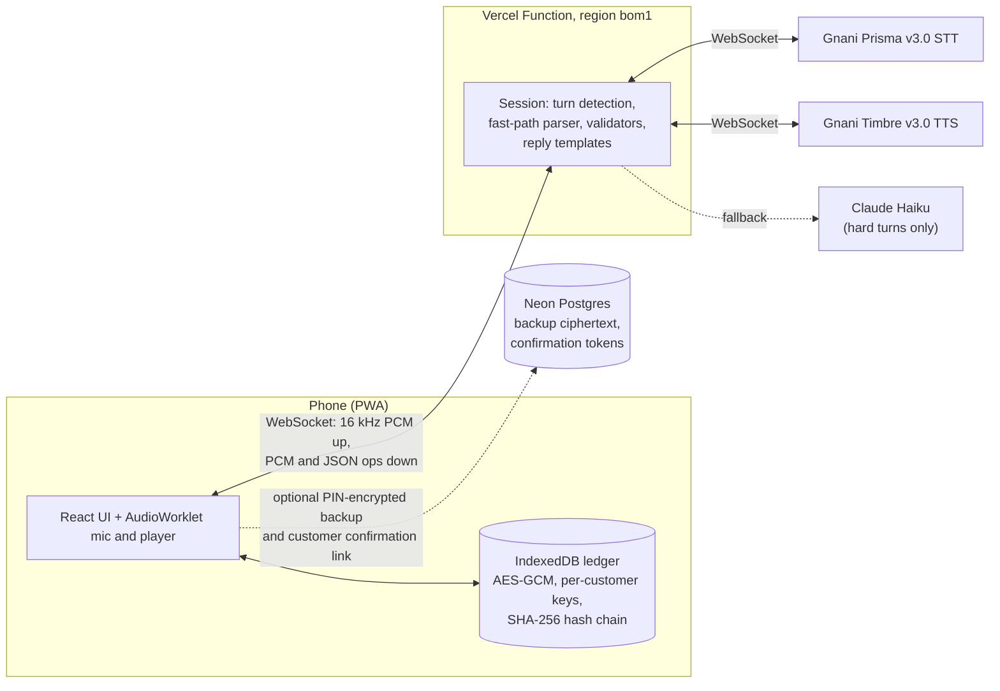
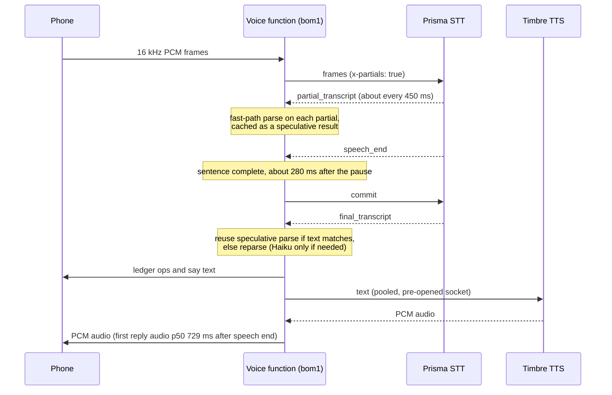

# Voice Khata

Voice Khata is a voice credit ledger for kirana shops, built for the Gnani Voice Hackathon (problem statement PS2). The shopkeeper speaks while serving a customer, in any of 10 Indian languages mixed with English, and the app records who owes what, tracks payments, and answers "Ramesh ka total?" by voice in under a second. The ledger lives encrypted on the phone.

**Hosted prototype:** https://voice-khata-delta.vercel.app

**Try it**
1. Open the link on a phone and pick your language on the tile screen.
2. Tap the mic and allow microphone access. The assistant introduces itself as an AI.
3. Say "Ramesh ka 340 udhaar", then ask "Ramesh ka total?".

## What it does well

| Rubric area | What the app does |
|---|---|
| Exact amount | Digits come from Prisma `transcribe` format. Our own parser also reads number words in 10 languages, including fraction words (sawa, saadhe, paune, dedh, dhai and the Dravidian suffixes) and dropped scale ("teen chaalis" = 340). Sound-alike pairs such as 60/7, 70/17, 15/50 and 3/30 are flagged, and the agent asks "60 ya 7?" instead of guessing. An amount far outside a customer's usual size is also confirmed. |
| Credit or payment | Decided from case markers ("ne" means payment, "ko" means credit) and, in Kannada, Tamil and Telugu, from the verb person. When direction cannot be read, the agent asks. |
| Corrections and undo | "Nahi, 430", "galat, jama tha", "Ramesh nahi Suresh" amend the last entry. "Hata do" voids it. Nothing is erased; an amend or void is a new event in the log. |
| Noise | A server-side energy tracker estimates the shop's noise floor and each utterance's SNR. When the SNR is below 11 dB, or cannot be estimated, the agent reads the entry back and waits for a yes or no before saving. In a quiet shop it saves, speaks a read-back and shows an undo toast. |
| Latency and barge-in | Parsing runs on streaming partials. When the sentence is already complete, Prisma's `commit` frame is sent after a short pause instead of waiting for the silence timer. If the shopkeeper speaks over the agent, audio ducks at once and stops if it was real speech. TTS sockets are pre-opened. A latency waterfall is shown for every turn. |
| Languages | Hindi, English, Kannada, Tamil, Telugu, Malayalam, Marathi, Bengali, Gujarati, Punjabi. Reply templates exist for all 10. Hindi, Kannada, Tamil, Telugu and English have the deepest number and direction coverage. |
| Responsible AI | AI disclosure on the first turn, on-device encrypted ledger, opt-in reminders for adults, no customer scoring. See below. |

The deterministic parser handles most turns with no LLM call. Claude Haiku is called only for hard turns, and its output is validated: an amount that is not among the candidates found in the transcript is rejected.

## Architecture



The server keeps no ledger. On every (re)connect the phone sends a snapshot of customers, aliases, balances and the last entry; the server replies with ledger operations that the phone applies and writes to its encrypted store. Vercel functions run at most 300 s, so the client reconnects transparently.

### One turn, with measured latency



Measured on production (Vercel bom1), 7 Hindi conversation turns: speech end to first reply audio p50 729 ms, max 774 ms.

## Gnani services used

**Prisma v3.0 STT** (`wss://api.vachana.ai/stt/v3/stream`, WebSocket only)
- Headers: `x-api-key-id`, `model: prisma-v3.0`, `language_code` (exactly one locale; a list is rejected), `format: transcribe`, `x-sample-rate: 16000`, `x-partials: true`, `x-idle-timeout-sec`, `topic`, and `keyterms`.
- Input is 16 kHz s16le PCM in exact 1024-byte frames; the server re-frames whatever the phone sends.
- `format=transcribe` returns digits ("रमेश का 340 रुपये उधार"). `codemix` returns number words, which are harder to read exactly.
- `keyterms` biasing: the customer names in the ledger are sent as keyterms when the stream opens (non-ASCII JSON-escaped, up to 200), and can be replaced mid-session with `update_settings`.
- `commit` frame: once the transcript is a complete khata sentence and the speaker has paused, we send `commit` rather than wait for Prisma's silence timer.
- Finding: the `x-partials: true` header is not in the public docs. With it, Prisma streams `partial_transcript` events plus `speech_start` and `speech_end` events, and ends the turn with `final_transcript`. Without it you only get `processing` and `transcript`. Partials are what let us parse before the sentence ends.

**Timbre v3.0 TTS** (`wss://api.vachana.ai/api/v1/tts`, WebSocket only)
- Voice: Shivani, 16 kHz PCM.
- A pool of pre-opened sockets removes connect time, and one socket serves many requests. There is no cancel message, so on barge-in the listener is detached and the rest of that reply is drained and dropped.
- No voice cloning is used anywhere.

Orchestration (turn detection, parsing, validation, dialogue, barge-in) is our own code in `server/` and `shared/`.

## Responsible AI and privacy

- **AI disclosure.** The first turn of a session is spoken in the user's chosen language, for example: "I am Voice Khata, an AI assistant. Your ledger stays only on this phone."
- **Ledger stays on the device.** Entries are stored in IndexedDB, encrypted with AES-GCM. Each customer has their own key, and shop-level data has a shop key.
- **Erasure by crypto-shred.** Forgetting a customer deletes their key, so their records become unreadable. The hash chain covers ciphertext, so it still verifies afterwards.
- **Tamper-evident audit trail.** Every entry carries its transcript, confidence and parsing path, and is linked into a SHA-256 hash chain. A disputed entry is marked, never erased.
- **Optional backup.** A backup is encrypted on the phone with a key derived from a PIN (PBKDF2). The server stores ciphertext only.
- **Customer confirmation link.** Neon stores only a random token, the shop display name, amount, direction, date and the customer's response. No customer name and no phone number. Tokens expire after 30 days.
- **Reminders are opt-in.** A reminder is a WhatsApp share link that the shopkeeper sends. It is offered only for customers marked as opted in and as adults, and uses polite template text. A spoken request for a customer who has not opted in is declined.
- **No scoring.** The app does not rank, rate or comment on customers. It records what was said.
- **LLM boundaries.** Haiku is instructed never to judge a customer, and open-ended replies go through a guardrail filter with a template fallback.
- **Test data.** Only Gnani stock voices, public datasets and public noise recordings. No real customer data and no team voice recordings.
- **DPDP alignment.** The design follows the notice, consent, erasure, security and children's-data duties of India's Digital Personal Data Protection Rules (notified 14 Nov 2025; core duties apply from about May 2027). This is an engineering alignment, not a legal opinion.

## Evaluation

### Production, end to end

| Measure | Result |
|---|---|
| Hindi conversation on production, correct turns | 7 / 7 |
| Speech end to first reply audio | p50 729 ms, max 774 ms (Vercel bom1) |
| Early commit | fires about 280 ms after the pause when the sentence is complete |
| Haiku 5.5 parse (hard turns only) | p50 about 1.2 s; most turns use the deterministic parser with 0 ms LLM |
| Unit tests | 298 passing |

### STT noise benchmark (exact amount)

12 synthetic Timbre-voice utterances (mostly Hindi, one English, one Kannada; includes 7, 17, 60 and 70) mixed with noise at a fixed SNR. Each cell is amounts correct out of utterances. Source: `eval/results/noise_*.json`.

| Noise | 15 dB | 10 dB | 5 dB | 0 dB | -5 dB | -10 dB |
|---|---|---|---|---|---|---|
| Busy street (DEMAND STRAFFIC) | 12/12 | 12/12 | 12/12 | 12/12 | 11/12 | 4/12 |
| Cafeteria (DEMAND PCAFETER) | 12/12 | 12/12 | 12/12 | 12/12 | 7/12 | 2/12 |
| Public square (DEMAND SPSQUARE) | 12/12 | 12/12 | 12/12 | 12/12 | not run | not run |
| Hindi 4-talker babble (IndicVoices) | not run | 12/12 | 12/12 | 9/12 | 2/12 | 0/12 |

With no added noise, 12/12.

Plainly: amounts stay exact down to 0 dB for steady shop noise. Competing speech is harder: at 0 dB babble, 75% are right, and at lower SNR the speech is mostly not recoverable. That is why the agent reads back and asks when its SNR estimate is low. These runs test STT plus amount extraction, not the full dialogue, and 12 utterances per cell is a small sample.

### Multilingual noisy end to end

TODO: filled from eval/results/e2e_*.json

### End-of-turn model we measured and dropped

Smart Turn v3.2 on 37 khata utterances scored 64 to 72% accuracy and took 300 to 800 ms per call in WASM on Vercel, longer than the silence it would save. We use transcript completeness plus Prisma's `commit` instead. Details: `eval/TURN_DETECTION.md`.

## Setup

Requires Node 24 (developed on 24.15).

```bash
npm install
cp .env.example .env     # then fill in the values
npm run dev              # frontend (Vite)
```

Environment variables (names only; `.env` is gitignored):
- `GNANI_API_KEY`
- `ANTHROPIC_API_KEY`
- `DATABASE_URL` (optional; enables backup and confirmation links, set by the Neon integration on Vercel)
- `CRON_SECRET` (optional; protects the cleanup cron)

Run the voice server locally:

```bash
npx tsx --env-file=.env eval/local_server.ts
```

Tests and deploy:

```bash
npx vitest run
vercel deploy            # add --prod for production
```

## Repo layout

```
api/        Vercel functions: voice.ts (WebSocket session), backup.ts, confirm.ts, cleanup.ts
server/     session.ts (dialogue and turn flow), gnani/ (stt.ts, tts.ts), parse/llm.ts (Haiku), turn/energy.ts
shared/     numbers, intent, names, ledger, chain (hash chain, crypto-shred), replies (10-language templates), protocol
src/        React PWA: lib/ (store, voice client, backup), ui/, components/
public/     AudioWorklets (mic.js, player.js), icons
eval/       noise benchmark, e2e harness, local_server.ts, results/, TURN_DETECTION.md, NOISE_SOURCES.md
docs/       VIDEO_SCRIPT.md
```

## Test data licences

No real customer recordings, no team recordings, no cloned voices. From `eval/NOISE_SOURCES.md`:

| Source | Use | Licence |
|---|---|---|
| Gnani Timbre v3.0 stock voices | Synthetic shopkeeper utterances | Generated with our Gnani API key; stock voices only |
| DEMAND (Thiemann, Ito, Vincent, 2013): STRAFFIC, PCAFETER, SPSQUARE | Street, cafeteria and square noise | CC BY 4.0 |
| AI4Bharat IndicVoices (Hindi validation split) | Four overlapped real speakers as counter babble | CC BY 4.0 (gated; terms accepted) |

## Team

Atria Institute of Technology: Sulaiman Shariff (team leader), Hajira Noorain, K Mahi, Mahamad Zaid.

Team name: Purrfect. Team ID: team-8588FC8C5100.
