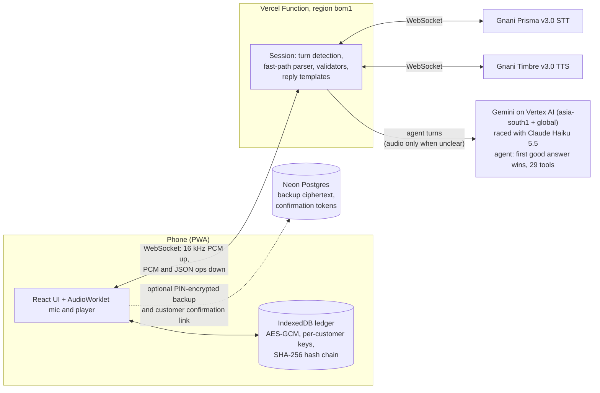
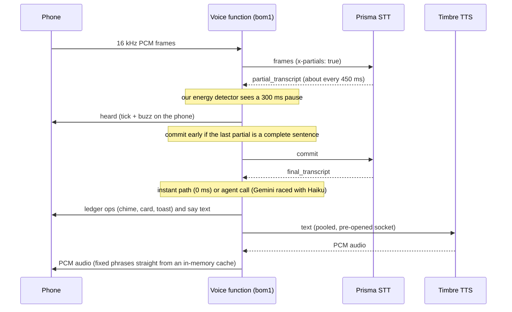

# KhataBhai

KhataBhai (formerly Voice Khata) is a voice credit ledger for kirana shops, built for the Gnani Voice Hackathon (problem statement PS2). The shopkeeper speaks while serving a customer, in any of 10 Indian languages mixed with English, and the app records who owes what, tracks payments, and answers "Ramesh ka total?" by voice. The ledger lives encrypted on the phone. Version 2 replaced the rule-and-LLM turn loop with a Gemini agent that picks one of 29 tools, each of which runs through the same ledger safety layer, and with a wake word so the app only acts when called.

**Hosted prototype:** https://khatabhai-nine.vercel.app

**Try it**
1. Open the link on a phone and pick your language on the tile screen.
2. Tap the mic and allow microphone access. The assistant introduces itself as an AI. It starts asleep.
3. Say "KhataBhai" (or tap the mic), then "Ramesh ka 340 udhaar", then ask "Ramesh ka total?". It stays awake for 15 s after each exchange; "bas" or "that's all" puts it to sleep.

## What it does well

| Rubric area | What the app does |
|---|---|
| Exact amount | Digits come from Prisma `transcribe` format. Our own parser also reads number words in 10 languages, including fraction words (sawa, saadhe, paune, dedh, dhai and the Dravidian suffixes) and dropped scale ("teen chaalis" = 340). Sound-alike pairs such as 60/7, 70/17, 15/50 and 3/30 are flagged, and the agent asks "60 ya 7?" instead of guessing. An amount far outside a customer's usual size is also confirmed. |
| Credit or payment | Decided from case markers ("ne" means payment, "ko" means credit) and, in Kannada, Tamil and Telugu, from the verb person. When direction cannot be read, the agent asks. |
| Corrections and undo | "Nahi, 430", "galat, jama tha", "Ramesh nahi Suresh" amend the last entry. "Hata do" voids it. Nothing is erased; an amend or void is a new event in the log. |
| Noise | A server-side energy tracker estimates the shop's noise floor and each utterance's SNR. When the SNR is below 11 dB, or cannot be estimated, the agent reads the entry back and waits for a yes or no before saving. In a quiet shop it saves, speaks a read-back and shows an undo toast. |
| Latency and barge-in | A soft tick and buzz about 300 ms after the shopkeeper stops, long before the reply. When the last partial is already a complete sentence, Prisma's `commit` frame is sent after a short pause instead of waiting for the silence timer. A save is confirmed in one spoken sentence with the customer's new balance, so the screen and the voice always agree. The chime, highlight and toast no longer wait for the encrypted write. If the shopkeeper speaks over the agent, audio ducks at once and stops if it was real speech. TTS sockets are pre-opened. A latency waterfall is shown for every turn. |
| Languages | Hindi, English, Kannada, Tamil, Telugu, Malayalam, Marathi, Bengali, Gujarati, Punjabi. Reply templates exist for all 10. Hindi, Kannada, Tamil, Telugu and English have the deepest number and direction coverage. |
| Responsible AI | AI disclosure on the first turn, on-device encrypted ledger, opt-in reminders for adults, no customer scoring. See below. |

A plain entry about a known customer (name, amount and a spoken credit or payment word) takes the instant path: the deterministic parser writes it with no model call. Everything else goes to the agent: Gemini and Claude Haiku 5.5 are asked at the same time and the first good answer is used. The agent only picks tools and fills arguments; the tools validate it (an amount that was not said is refused, a direction nobody said is read back).

## Architecture



The phone also runs a small wake-word detector (see Attention). The server keeps no ledger. On every (re)connect the phone sends a snapshot of customers, aliases, balances and the last entry; the server replies with ledger operations that the phone applies and writes to its encrypted store. Vercel functions run at most 300 s, so the client reconnects transparently.

### One turn, with measured latency



Measured on production (Vercel bom1, 13 Nov), 7 Hindi conversation turns: speech end to first reply audio p50 729 ms, max 774 ms.

**Making it feel instant (21 Nov, local A/B, same machine, 4 languages, clean and street noise).** `eval/latency_breakdown.ts` reads the server's per-turn timings.

| | Before | After |
|---|---|---|
| First thing heard or felt after speaking | the reply audio | tick at p50 320 ms |
| First reply audio sent (server, p50) | 988 ms | 835 ms |
| First audio on the client, clean p50 / p95 | 960 / 1,334 ms | 796 / 1,126 ms |
| First audio on the client, street p95 | 2,250 ms | 1,241 ms |
| Spoken reply length (p50) | 3.0 s | 2.0 s |
| Done talking (p50) | 4.0 s | 3.4 s |
| Exact amounts | 60/60 clean, 56/60 street | 60/60 clean, 57/60 street |

On Vercel (bom1, measured from the same machine, same suite): production before 912 / 1,682 ms (clean p50 / p95) and 991 / 2,215 ms (street), against a preview with these changes at 843 / 1,263 ms and 907 / 1,212 ms. Exact amounts were the same (60/60 clean, 56/60 street, 0 silent wrong). The preview was reached with the local Vercel development OIDC token (`x-vercel-trusted-oidc-idp-token`, read by `eval/e2e_suite.ts`). Measuring it found the per-IP session guard refusing new sessions from a client that had at most 4 open, because the server learns of a close late. The limit is now 12, each socket frees its slot once, and a 30 s ping terminates dead sockets.

Where a clean turn's time goes: Prisma's final transcript arrives about 800 ms after the shopkeeper stops, parsing takes 0 ms, and Timbre starts in about 150 ms (0 ms for cached phrases). Timbre's time to first audio does not grow with text length (a 300-character paragraph starts as fast as "लिख दिया"), so replies are not split into pieces. The end of turn is left as it is: Prisma's partials lag about one word, and committing on `speech_end` was measured and did not help.

## Attention: when it listens

The app is asleep until it is called, so a shop's chatter is not acted on.

- **Waking:** a tap on the mic, a hold of the mic (stays awake while held), or the wake word "KhataBhai". The phone runs the trained wake-word model `public/wakeword/khatabhai.onnx` (`src/lib/wake/`, onnxruntime-web in a worker, threshold 0.6). While asleep behind it, no audio leaves the phone; on a detection the last 2 s are sent and the server confirms the word in the transcript (`shared/wake.ts`, phonetic match across scripts: "खाता भाई", "Khata Bhai"), or goes back to sleep. If the model cannot load, the phone falls back to streaming and the server spots the word itself. Misheard forms ("Hata bhai", "Khadha bhai") wake only a sleeping app, and "aata bhai" (aata is flour) only confirms a phone detection; while awake they are ordinary words ("hata bhai" is an undo).
- **Wake model, measured** (`npx tsx eval/wake_detector.ts`, the app's own inference path on onnxruntime-web WASM in Node): the trainer's held-out positives 21/21 woke; addressed synthetic counter lines 30/30; about 14.5 false wakes per hour from a bare "khata" (no "bhai") in the synthetic counter scenes, which the server's transcript check sends back to sleep; pure shop noise 0 false wakes per hour; about 2 ms of inference per 80 ms chunk.
- **Awake:** 15 s after the app last answered (a reply, a write or a question; `server/attention.ts`). It never goes back to sleep while a question is open and younger than 45 s, nor in the middle of an utterance. Speech that is not for the app makes the agent call `not_for_me`, which shows the line dimmed, writes nothing and does not extend the 15 s, so talk to customers lets the app fall asleep. Going to sleep drops a question that has expired.
- **Sleep words:** "bas", "that's all", "go to sleep" and equivalents.
- **Listening languages:** the session's language plus `LISTEN_LANGS` (default `en-IN,hi-IN,kn-IN`) at once, one Prisma stream each on the same audio (`server/gnani/multi.ts`). The agent sees every transcript.

## The agent and its tools

`server/agent/agent.ts` asks the model once per turn with the transcripts of all streams, the last few exchanges, the screen, the customer names, the latest numbered entries and the open question. It answers only with tool calls (several per turn are allowed). If the transcripts cannot be trusted it calls `unclear`; the utterance audio (up to 20 s) is then sent in one second call to a model that hears audio (`AGENT_AUDIO_MODEL`), inside a 2 500 ms budget.

**Two models race on every text turn.** `decide()` starts the Gemini race (Mumbai plus two `global` requests, `server/parse/gemini.ts`) and one Claude Haiku 5.5 call (`claude-haiku-5-5`, `server/parse/haiku.ts`) at the same moment, with the same prompt and tools. The first answer that names a tool we have wins and the other leg is cancelled. One deadline covers both (`LLM_TIMEOUT_MS`, 3 s, plus the session's own cut-off): if one side fails (an outage, a 429, a bad key, a refusal, no tool call) the other still has the rest of it; if both fail the turn ends in "didn't catch that", as before. Which model answers depends on timing, and `agent_call` in the logs says which one did (`model=`). Haiku runs with thinking off at effort `low`, a forced tool choice, no retries, and a cached system prompt. The audio second call stays Gemini only. Both models go through the same tools and the same safety rules below, so neither can write anything the other could not. `AGENT_HAIKU=off`, or no `ANTHROPIC_API_KEY`, turns Haiku off.

The 29 tools (`server/agent/tools.ts`):
- Entries: `add_entries`, `change_entry`, `remove_entry`, `undo_last`, `move_entry`, `settle`.
- Show and ask: `show_customer`, `show_dues`, `show_history`, `show_today`, `search`, `top_debtors`, `close_view`, `query_balance`.
- Customers: `add_customer`, `rename_customer`, `merge_customers`, `set_phone`, `send_reminder`, `send_statement`.
- Settings: `set_language`, `set_speed` (slower, normal, faster), `set_shop_name`, `open_privacy`, `backup`, `erase_all`. Every save is spoken in full with the customer's new balance; there is no setting to shorten it.
- Dialogue: `answer_question`, `not_for_me`, `unclear`.

### Safety rules (enforced in code, not in the prompt)

- An amount that was not in what was heard is dropped; an entry is never written from an amount the model made up.
- A direction (credit or payment) nobody said is read back before saving, as is a name that differs from what was heard.
- A heard name that is not in the ledger is never written without a yes. Two customers that fit a name give a "which one" question.
- Remove, move, merge, settle and erase always ask first. `undo_last` is instant only for an entry written in this session in the last 60 s.
- `erase_all` erases only when the shopkeeper types the word shown on screen; a spoken or tapped yes never does.
- `send_reminder` needs opt-in and an adult customer, and only prepares a WhatsApp share; the shopkeeper taps send.
- `answer_question` takes yes, no or an amount only from what was heard, never from the model. An on-screen option the model picks counts only when what was heard picks it too (the amount was said, or the name, "doosra" or "300 wala" points at it).
- A spoken undo ("hata do") is instant only for an entry this session wrote in the last 60 s; an older one is read back first.
- "Save anyway" on a dimmed line is handled as addressed to the app, but its words are still speech: a new name in it is read back first.
- The same entry is never written twice within 60 s, and every write from an audio reading is read back.
- If the agent call fails or times out, a plain entry still saves through the parser; anything else gets "did not catch that" in the turn language.

## Gnani services used

Every claim below was checked against the live API with the probe scripts `eval/probe_gnani*.ts`.

**Prisma v3.0 STT, realtime** (`wss://api.vachana.ai/stt/v3/stream`)
- Headers: `x-api-key-id`, `model: prisma-v3.0`, `language_code`, `format: transcribe`, `x-sample-rate: 16000`, `x-partials: true`, `x-idle-timeout-sec`, `topic`, `keyterms`. The VAD headers (`x-min-silence-ms`, `x-min-segment-ms`, `x-vad-threshold`) are optional, through env.
- VAD silence, measured: with no header, `speech_end` arrived about 1,250 ms after an isolated clip ended (the docs say the default is 500 ms). With `x-min-silence-ms` at 300, 500 and 700 it arrived after about 320, 620 and 1,000 ms. In the full e2e suite, 500 ms gave no measurable end-to-end gain, because our early commit already ends complete sentences sooner, so it is off by default.
- Where a clean turn's time goes (76 turns, hi/kn/ta/te, local server): final transcript at p50 812 ms after speech end, parse 0 ms, Timbre first audio 212 ms after the final, first audio sent at p50 1,035 ms. Our early commit fired on about 25% of turns. On the rest, Prisma's last partial is one word short (it reads "रमेश का 150"; the final reads "रमेश का 150 उधार।"), so the sentence never looks complete before Prisma finalizes. Committing on `speech_end` was measured and gave no gain.
- A shorter silence window splits a sentence at a breath ("रमेश का।" then "340 रुपये उधार।"). The session holds a line that ends on a case marker or conjunction and joins it to the next one, as it already did for lists.
- `language_code` is a single locale on realtime. A list is rejected ("exactly one locale"). The `multi_lang_codes` header named in that error is accepted but changes nothing. `update_settings` with `language_code` does switch a live stream without a reconnect.
- `detected_language_code` comes back on each final. When it names another supported language and the turn reads as a ledger turn, the session switches to that language. English never triggers a switch (Hinglish is normal), and neither does Hindi to Marathi or back (same script).
- The stream is refreshed at a quiet moment after 14 minutes, before Prisma's 15-minute cap closes it with code 1001.
- Input is 16 kHz s16le PCM in exact 1024-byte frames; the server re-frames whatever the phone sends.
- `format=transcribe` returns digits ("रमेश का 340 रुपये उधार"). `codemix` returns number words, which are harder to read exactly.
- `keyterms` biasing: the customer names in the ledger are sent as keyterms when the stream opens (non-ASCII JSON-escaped, up to 200), and can be replaced mid-session with `update_settings`.
- `commit` frame: once the transcript is a complete khata sentence and the speaker has paused, we send `commit` rather than wait for Prisma's silence timer.
- Finding: the `x-partials: true` header is not in the public docs. With it, Prisma streams `partial_transcript` events plus `speech_start` and `speech_end` events, and ends the turn with `final_transcript`. Without it you only get `processing` and `transcript`. Partials are what let us parse before the sentence ends.


**Timbre v3.0 TTS** (`wss://api.vachana.ai/api/v1/tts`, WebSocket only)
- One female voice per language, each from Gnani's recommended list for that language: Shivani (hi/mr/bn/gu), Sunaina (en/ml), Sneha (kn), Kalpana (ta/te/pa). 16 kHz PCM. `eval/tts_roundtrip.ts` speaks each language's saved-entry reply with an amount and reads it back through Prisma. For Malayalam we tried Tarika, Rajni, Shubham, Sunaina and Shivani, and Sunaina came back most exactly. Spoken 17 is sometimes heard as 15 (പതിനഞ്ച്) with every voice.
- `<pauses>` audio tags between names in list read-backs. Tags are removed from the on-screen text and from echo matching.
- `speed: 1.2` when "Faster replies" is on in Settings (it changes mid-session).
- A pool of pre-opened sockets removes connect time, and one socket serves many requests. There is no cancel message: a probe sent `{"type":"cancel"}` and 94 of 96 chunks still arrived. On barge-in the listener is detached, and the rest of that reply is drained and dropped.

- No voice cloning is used anywhere.

Orchestration (attention, turn detection, the agent's tools, validation, dialogue, barge-in) is our own code in `server/` and `shared/`. The agent models are Gemini on Vertex AI and Claude Haiku 5.5 on the Anthropic API, not Gnani services.

## Responsible AI and privacy

- **AI disclosure.** The first turn of a session is spoken in the user's chosen language, for example: "I am KhataBhai, an AI assistant. Your ledger stays only on this phone."
- **Server logs include what was said.** The voice function writes one structured JSON log line per event (`server/log.ts`). For each turn that is the transcript, the parsed intent, the reply text, the ledger operations (customer id, amount, direction) and timings. Customer names and amounts therefore appear in Vercel's runtime logs, which keep them for about an hour on the current plan. Never logged: API keys and tokens (masked by field name), the phone's ledger snapshot (only counts), raw IP addresses (a short one-way hash), and backup ids, confirmation tokens or backup contents (the other endpoints log method, path, status and timing only). `LOG_LEVEL=debug` adds partial transcripts, commits and per-reply TTS detail.
- **Ledger stays on the device.** Entries are stored in IndexedDB, encrypted with AES-GCM. Each customer has their own key, and shop-level data has a shop key.
- **Erasure by crypto-shred.** Forgetting a customer deletes their key, so their records become unreadable. The hash chain covers ciphertext, so it still verifies afterwards.
- **Tamper-evident audit trail.** Every entry carries its transcript, confidence and parsing path, and is linked into a SHA-256 hash chain. A disputed entry is marked, never erased.
- **Optional backup.** A backup is encrypted on the phone with a key derived from a PIN (PBKDF2). The server stores ciphertext only.
- **Customer confirmation link.** Neon stores only a random token, the shop display name, amount, direction, date and the customer's response. No customer name and no phone number. Tokens expire after 30 days.
- **Reminders are opt-in.** A reminder is a WhatsApp share link that the shopkeeper sends. It is offered only for customers marked as opted in and as adults, and uses polite template text. A spoken request for a customer who has not opted in is declined.
- **No scoring.** The app does not rank, rate or comment on customers. It records what was said.
- **LLM boundaries.** The agent can only call tools, never speak free text; replies are our templates, and the model is told never to judge a customer. The transcripts are sent to Google Vertex AI: to asia-south1 (Mumbai) and, to hold the latency budget, at the same time to the Vertex `global` endpoint, whose serving region Google chooses (each agent turn sends about 3 requests, one Mumbai and two global; `AGENT_HEDGE_MS=off` sends Mumbai only). For an unclear turn the utterance audio is sent once more, to Mumbai only. Each text agent turn is also sent to Anthropic (Claude Haiku 5.5, one request), so an agent turn makes about 4 model requests in all, roughly four times the cost of a single call; `AGENT_HAIKU=off` stops the Anthropic request. Instant-path turns make no call.
- **Asleep means not acted on.** With the on-phone wake model loaded, no audio leaves the phone while asleep (only the 2 s around a detection, for the server to confirm). If the model cannot load, the phone falls back to streaming and the server discards the audio until it hears the wake word.
- **Test data.** Only Gnani stock voices, public datasets and public noise recordings. No real customer data and no team voice recordings.
- **DPDP alignment.** The design follows the notice, consent, erasure, security and children's-data duties of India's Digital Personal Data Protection Rules (notified 14 Nov 2025; core duties apply from about May 2027). This is an engineering alignment, not a legal opinion.

## Evaluation

### Production, end to end

| Measure | Result |
|---|---|
| Hindi conversation on production, correct turns | 7 / 7 |
| Speech end to first reply audio | p50 729 ms, max 774 ms (Vercel bom1) |
| Early commit | fires about 280 ms after the pause when the sentence is complete |
| Agent eval (46 sentences x 2 passes) | 84 / 92 correct, silent wrong 0, p50 550 ms, p90 1 126 ms (see below) |
| Live agent turns (production, 22 Nov) | `eval/text_dialogue.ts` against the live site: 13 / 13 passed; the 5 agent calls it made took 374 to 604 ms inside the function (`agent_call` log line); instant-path turns made no call |
| Unit tests (`npx vitest run`, 22 Nov) | 439 passing, 6 skipped |

### Agent eval

`npx tsx --env-file=.env eval/agent_eval.ts` runs 16 hard sentences (ones the parser cannot settle, noisy or mixed-language, asides, corrections) and 30 control sentences (show, settings, customers, queries) through `decide` with the real tool list, then runs the calls through the app's own tools (`runTool`) on a fresh ledger. **Silent wrong** means those tools wrote or changed an entry at once, with no question, and it was not what the sentence meant.

22 Nov, Vertex asia-south1, gemini-3.5-flash-lite, 2 passes, 15 s timeout per call (the 3 s production default is too tight from a distant dev machine: a first run at 3 s lost 51 of 92 calls to timeouts and one 429):

| Measure | Result |
|---|---|
| Correct tool and arguments | 84 / 92 |
| Silent wrong | 0 |
| Failed calls | 0 |
| Latency p50 / p90 (text only, from the dev machine) | 550 ms / 1 126 ms |

The 8 misses are 4 sentences, twice each, and all safe: "Ramesh 340" (the agent chose `undo_last` or `show_customer`; `undo_last` asks because nothing was written this session), and three promise or "add 200" lines where the agent left direction null, so the app asks instead of writing. An earlier scoring on the raw tool arguments flagged 4 silent wrongs ("Deepak ne saath rupaye diye" read as 60 payment, "Sunitu dobar 1,000 on credit"); the app's own tools turn those into read-backs, which is why silent wrong is scored on what the tools actually write.

**Gemini, Haiku and the race** (`--model gemini|haiku|race`; 22 Nov, from the dev machine, 1 pass of the 46 sentences each; `gemini` and `haiku` alone with a 15 s timeout, `race` exactly as the app runs it, with the 3 s deadline):

| Model | Correct | Silent wrong | Failed | p50 / p90 | Answer used |
|---|---|---|---|---|---|
| Gemini race alone | 44 / 46 | 0 | 0 | 1 708 ms / 5 329 ms | Gemini 46 |
| Haiku 5.5 alone | 39 / 46 | 0 | 0 | 934 ms / 1 159 ms | Haiku 46 |
| Both raced (the app) | 39 / 46 | 0 | 0 | 950 ms / 1 112 ms | Haiku 45, Gemini 1 |

In this run Gemini was in a slow spell, so Haiku won almost every race; the race took the tail from 5.3 s to 1.1 s but scored 5 fewer sentences right. Haiku's extra misses are all safe (nothing written): "speak in Kannada" (`unclear`), "normal speed mein bolo" and "Pinky ki mummy aayi thi, paanch sau de gayi" (`not_for_me`), "nahi nahi, wo Suresh tha Ramesh nahi" (`unclear`), and "Sharma ji wale ka hisaab mein do sau aur jod do" (direction left open, so the app asks). It shares Gemini's two promise misses. Silent wrong stays 0 for all three: the tools hold the safety line whichever model answers. When Gemini is quick (its p50 has been about 0.5 s) it wins more races; the live `agent_call` lines show the split.

**Against the 3 s budget.** The product budget is 3 s from the end of speech to the reply. With the race (Mumbai plus two `global` requests, first answer wins; Task 16 bench, `eval/agent_latency.ts`, real contexts) the agent call is p50 about 1.4 s and p90 about 2.3 s, against Mumbai alone at p50 2.2 s and p90 5.5 s in a congested spell. Earlier, the agent call took 374 to 604 ms inside the function on the live site (5 calls), but a typed turn through the WebSocket took 1.0 to 3.6 s end to end (13 turns, the 3.6 s one a three-entry read-back), and earlier measurements of agent turns with speech put the p90 at about 3.5 to 4 s. That is over the 3 s budget at p90. The instant path (no model call) is well inside it. These are small samples.

### Audio for unclear moments

The agent first reads the words (all streams' transcripts). Only when it answers `unclear` is the utterance audio (up to 20 s) sent in a second call, and only inside a 2 500 ms budget counted from the start of the first call; over budget or still unclear, the shopkeeper is asked to repeat. Every write from an audio reading is read back (`from-audio` is a hard reason). Measured with `eval/audio_latency.ts` (20 synthetic addressed lines, about 3 s each, Vertex asia-south1, three live runs; the first two runs ignored failed calls, the third counts a failed or timed-out call as the 15 s timeout and prints the error rate):

| Model | Cold first call | Warm p50 | Warm p95 (n=20) | Errors |
|---|---|---|---|---|
| gemini-3.5-flash-lite | 3.2 s, 7.7 s, or timeout | 1.34 - 1.54 s | 2.3 s, 7.1 s, 9.1 s | 0/20 in the counted run (one warm-up timeout in run 2) |
| gemini-3.5-flash | 1.5 - 2.5 s | 1.84 - 2.08 s | 3.9 s, 6.9 s, 14.5 s | 0/20 in the counted run |

Latency varies a lot from run to run (occasional multi-second spikes), so the 2 500 ms cut-off in the session is what protects the reply time. `AGENT_AUDIO_MODEL` selects the model; the default is `gemini-3.5-flash-lite` (best p50, and the only one that met p95 <= 2 500 ms, in one of three runs). flash-lite's cold first call is about 3 to 8 s or a timeout, so the first audio retry after a cold start is usually cut off and the shopkeeper is asked to repeat.

### Replaying real conversations

Every production session in the logs becomes a replayable conversation: `eval/logs_to_corpus.py` turns `vercel logs --json` dumps into steps (what was said, tapped or typed, plus the model readings logged for each text), and `eval/corpus/label_prod.py` adds what the shopkeeper meant. `npx tsx eval/replay.ts` runs every conversation through the Session with no audio and no network (the model's answers are the logged ones) and counts:

- wrong entries;
- accounts opened under a name that is not a customer;
- entries meant but not written;
- turns with a name or an amount that got no reply;
- questions asked.

A read-back the logged user never got to answer is answered from the labels (yes only for an entry they meant). The logged model answers are from before v2; the v2 agent's answers are supplied from that cache or an oracle, so the replay checks the session's rules, not the model.

28 sessions from 21 Nov (105 steps, 30 entries meant):

| | Before (277e8b0) | After |
|---|---|---|
| Wrong entries | 3 | 0 |
| Junk accounts ("ಬರೀ" = "write", "Talk" from "took") | 2 | 0 |
| Entries missed | 2 | 1 |
| Silent on a name or an amount | 10 | 2 |
| Questions asked | 15 | 31 |

What changed is how a conversation becomes entries, not a list of words:

- **A heard name that is not in the ledger is always read back before an account is opened.** "New customer Mahi: 300 rupees on credit, correct?" Typed names are taken as written.
- **One entry can be built over several turns.** A name said on its own (a known customer, or said as a name: "ಮಾಹಿ ಹೆಸರಿಂದ") asks "how much?". An amount on its own asks "whose name?". Each answer fills only the blank that was asked, so "300 ಬರೀ" ("write 300") fills the amount and is not read as a name. A credit/paid word in any answer fills that blank too.
- **An answer is short.** A stray word or longer talk with no money in it keeps the open question on screen without speaking.
- **Talk to someone else is shown dimmed on the phone, marked "not an entry"**, so it is clear it was heard.

A name close to one customer ("Mahe" for Mahi) is read back under the customer's name. The same line said twice in one turn is one entry. The cost is more questions; every extra question is a read-back where a guess used to be written.

### STT noise benchmark (exact amount)

12 synthetic Timbre-voice utterances (mostly Hindi, one English, one Kannada; includes 7, 17, 60 and 70) mixed with noise at a fixed SNR. Each cell is amounts correct out of utterances. Source: `eval/results/noise_*.json`.

| Noise | 15 dB | 10 dB | 5 dB | 0 dB | -5 dB | -10 dB |
|---|---|---|---|---|---|---|
| Busy street (DEMAND STRAFFIC) | 12/12 | 12/12 | 12/12 | 12/12 | 11/12 | 4/12 |
| Cafeteria (DEMAND PCAFETER) | 12/12 | 12/12 | 12/12 | 12/12 | 7/12 | 2/12 |
| Public square (DEMAND SPSQUARE) | 12/12 | 12/12 | 12/12 | 12/12 | not run | not run |
| Hindi 4-talker babble (IndicVoices) | not run | 12/12 | 12/12 | 9/12 | 2/12 | 0/12 |

With no added noise, 12/12.

Plainly: amounts stay exact down to 0 dB for steady shop noise. Competing speech is harder: at 0 dB babble, 75% are right, and at lower SNR the speech is mostly not recoverable. That is why the agent reads back and asks when its SNR estimate is low. These runs test STT plus amount extraction, not the full dialogue, and 12 utterances per cell is a small sample.

### End-of-turn model we measured and dropped

Smart Turn v3.2 on 37 khata utterances scored 64 to 72% accuracy and took 300 to 800 ms per call in WASM on Vercel, longer than the silence it would save. We use transcript completeness plus Prisma's `commit` instead. Details: `eval/TURN_DETECTION.md`.

## Setup

Requires Node 24 (developed on 24.15).

```bash
npm install
cp .env.example .env     # then fill in the values
npm run dev              # frontend (Vite)
```

Environment variables (names only; `.env` is gitignored):
- `GNANI_API_KEY`
- `VERTEX_PROJECT`, `GOOGLE_VERTEX_KEY` (Gemini on Vertex AI; `GOOGLE_VERTEX_KEY` is the base64 service-account JSON)
- `ANTHROPIC_API_KEY` (Claude Haiku 5.5, raced against Gemini on every text agent turn; without it the agent is Gemini only), `AGENT_HAIKU` (`off` turns the Haiku leg off even with a key)
- `DATABASE_URL` (optional; enables backup and confirmation links, set by the Neon integration on Vercel)
- `CRON_SECRET` (optional; protects the cleanup cron)
- `LOG_LEVEL` (optional; `debug`, `info` (default), `warn` or `error`)
- `VERTEX_LOCATION` (default `asia-south1`), `GEMINI_MODEL` (default `gemini-3.5-flash-lite`), `AGENT_AUDIO_MODEL` (model for the audio second call, default `gemini-3.5-flash-lite`), `LLM_TIMEOUT_MS` (agent call timeout, default 3000; it covers an access-token refresh too)
- `AGENT_HEDGE_MS` (delay before the extra agent requests start; default 0, all at once; `off` sends Mumbai only), `AGENT_HEDGE_LOCATION` (where the extra requests go, comma-separated, one request each; default `global,global`)
- `LISTEN_LANGS` (default `en-IN,hi-IN,kn-IN`; languages heard in every session, `off` for the session language only)
- `STT_MIN_SILENCE_MS`, `STT_VAD_THRESHOLD` (optional; Prisma realtime VAD tuning, not sent unless set)
- `KB_RECORD_DIR`, `VK_DEBUG` (optional; local debugging)

Run the voice server locally:

```bash
npx tsx --env-file=.env eval/local_server.ts
```

Tests and deploy:

```bash
npx vitest run
vercel deploy            # add --prod for production
```

## Bad networks

The production logs of a real test showed what used to go wrong. The phone switched from Wi-Fi to mobile data while the server was answering "Suleman gave me 300. Mahi gave me 400.". The server had saved both lines, but the phone never received them, and nothing said so. The old link had stalled long before anyone noticed. Now:

- **No turn is lost silently.** The phone tracks each turn from its transcript to its end. If the connection drops after the transcript but before the ledger changes arrive, the next session handles the same text again and says so: "नेटवर्क टूट गया था, फिर से लिख रहा हूँ।" followed by the full read-back. A turn re-sent this way stays pending until its result arrives, so a second drop sends it again. Ledger changes carry a sequence number and the phone acknowledges each batch; changes never acknowledged are logged as `ops_unacked`. The phone skips an entry or customer it already has, so nothing is saved twice.
- **Dead links are found in seconds, not 30.** The phone pings every 4 s and treats 9 s of silence from the server as a dead link. On `online`/`offline` and network-type changes it checks the link at once (a reply is expected within 3 s). Reconnects start after 250 ms. A banner says "No network — nothing is being saved" or "Slow network — replies will be late" (ping over 1.2 s, or about 2 s of audio stuck in the socket buffer). The server's own heartbeat is 15 s.
- **Speech during a drop is kept.** The phone holds the last 12 s of mic audio. After reconnecting it replays what came after the server last answered (up to 10 s, and only if it contains speech). The server feeds it to Prisma at 3x real time. Prisma transcribed 1x, 2x and 4x replays identically (`eval/probe_gnani5.ts`).
- **An open question survives.** Every turn end carries the session's state: the open question with its drafts, who the conversation is about, the last few lines and the language. The phone hands it back on reconnect and on the planned 300 s socket swaps, so "haan" still answers "Ramesh 15,000, sahi hai?" after a drop.

`eval/net_chaos.ts` runs these through a local bad-network proxy (`eval/netsim.ts`), all passing:
1. killed after the transcript;
2. uplink stalled mid-sentence;
3. killed with a question open;
4. 400 ± 150 ms latency;
5. killed after the entry arrived (no duplicate);
6. server gone silent (reconnected in about 9 s).

## Logs

- Server: JSON lines on stdout/stderr, filterable in the Vercel log viewer or with `vercel logs <deployment-url> --json`. Every line has `ev` (event), `sid` (session) and `ip` (hashed). Main events: `conn_open`/`conn_close`/`conn_rejected`, `hello`, `stt_open`/`stt_ready`/`stt_closed`/`stt_error`, `final`, `held`/`held_joined`, `turn` (transcript, intent, reply, ops, all timings), `agent` (transcript, ms, tool names), `agent_call` (winning model, ms of the whole race, number of calls, Haiku's prompt-cache hits when it won), `agent_audio`/`agent_audio_failed`, `agent_failed`, `barge_in`, `tts_error`/`tts_timeout`, `session_end`.
- Latency report from a log: `npx tsx eval/latency_breakdown.ts server.log`.
- Browser: open the app with `?log=1` (remembered; `?log=0` turns it off) or switch on "Debug logs" in Settings. Console lines look like `[vk +12.345s] socket_open {ms: 312}`. Warnings and errors are always printed.

## Repo layout

```
api/        Vercel functions: voice.ts (WebSocket session), backup.ts, confirm.ts, cleanup.ts
server/     session.ts (turn flow), attention.ts, agent/ (agent.ts, tools.ts), ledger/core.ts (safety layer), gnani/ (stt.ts, multi.ts, tts.ts), parse/ (gemini.ts, llm.ts), turn/energy.ts
shared/     wake (wake word, sleep words), numbers, intent, names, ledger, chain (hash chain, crypto-shred), replies (10-language templates), protocol
src/        React PWA: lib/ (store, voice client, backup, wake/ on-phone detector), ui/, components/
public/     AudioWorklets (mic.js, player.js), icons
eval/       agent_eval.ts, replay.ts, audio_latency.ts, noise benchmark, e2e harness, local_server.ts, results/, TURN_DETECTION.md, NOISE_SOURCES.md
docs/       VIDEO_SCRIPT.md
```

## Test data licences

No real customer recordings, no team recordings, no cloned voices. From `eval/NOISE_SOURCES.md`:

| Source | Use | Licence |
|---|---|---|
| Gnani Timbre v3.0 stock voices | Synthetic shopkeeper utterances | Generated with our Gnani API key; stock voices only |
| DEMAND (Thiemann, Ito, Vincent, 2013): STRAFFIC, PCAFETER, SPSQUARE | Street, cafeteria and square noise | CC BY 4.0 |
| AI4Bharat IndicVoices (Hindi validation split) | Four overlapped real speakers as counter babble | CC BY 4.0 (gated; terms accepted) |

## Team

Atria Institute of Technology: Sulaiman Shariff (team leader), Hajira Noorain, K Mahi, Mahamad Zaid.

Team name: Purrfect. Team ID: team-8588FC8C5100.
